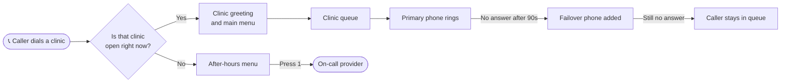

<div align="center">

# 📞 Phone Tree Simulator

**Interactive call-routing simulators and recorded menu prompts for A Plus Family HealthCare**

[](https://bbagshawapfhc.github.io/call-sim-audio/v5/call-sim.html)


[**Call Simulator**](https://bbagshawapfhc.github.io/call-sim-audio/v5/call-sim.html) ·
[**Flow Diagram**](https://bbagshawapfhc.github.io/call-sim-audio/v5/interactive-flow-diagram.html) ·
[**Visualizer**](https://bbagshawapfhc.github.io/call-sim-audio/v5/interactive-visualizer.html)

</div>

---

## Contents

- [Overview](#overview)
- [Apps](#apps)
- [How Calls Route](#how-calls-route)
- [Clinic Hours](#clinic-hours)
- [Audio Prompts](#audio-prompts)
- [Repository Layout](#repository-layout)
- [Notes](#notes)

---

## Overview

This repository hosts browser-based simulators of the A Plus Family HealthCare phone tree, along with the recorded menu prompts they play. They let staff and leadership see how a call moves through the system before changes go live: which menu a caller hears, which phones ring, and what happens after hours.

> [!TIP]
> Nothing to install or sign into. Open any app link in a modern browser (Edge, Chrome, Firefox, or Safari) with an internet connection.

---

## Apps

<table>
  <tr>
    <td width="33%" valign="top">
      <h3>🎧 Call Simulator</h3>
      <p>Place a simulated call to any clinic. Hear the real recorded prompts, use the keypad, and follow a live trace of every routing step.</p>
      <a href="https://bbagshawapfhc.github.io/call-sim-audio/v5/call-sim.html"><b>Launch →</b></a>
    </td>
    <td width="33%" valign="top">
      <h3>🗺️ Flow Diagram</h3>
      <p>A clickable map of the full call path. Choose a clinic, day, time, and menu option to highlight exactly where the call goes.</p>
      <a href="https://bbagshawapfhc.github.io/call-sim-audio/v5/interactive-flow-diagram.html"><b>Launch →</b></a>
    </td>
    <td width="33%" valign="top">
      <h3>🌅 Visualizer</h3>
      <p>An animated day/night clock that shows which clinics are open at any moment, with a test dialer for each location.</p>
      <a href="https://bbagshawapfhc.github.io/call-sim-audio/v5/interactive-visualizer.html"><b>Launch →</b></a>
    </td>
  </tr>
</table>

All three apps have a **Staging / Production** toggle. Staging shows the test phone numbers, and Production shows each clinic's public number.

---

## How Calls Route



| Principle | Behavior |
| --- | --- |
| **Site-only answering** | A call to a clinic rings only that clinic's phones, never another location's. |
| **Ring order** | The primary phone rings first. After 90 seconds, the failover phone(s) are added. |
| **No voicemail** | Unanswered callers stay in the queue. |
| **Refill line** | Refill requests (press 4) stay with the clinic's own staff. |
| **After hours** | Outside a clinic's hours, calls go to the after-hours menu, where pressing 1 reaches the on-call provider. |

---

## Clinic Hours

| Clinic | Mon | Tue | Wed | Thu | Fri | Sat / Sun |
| --- | :---: | :---: | :---: | :---: | :---: | :---: |
| **Brownsville** (Central) | 8–5 | 8–5 | 7–4 | 8–5 | 8–5 | Closed |
| **Sonora** (Eastern) | 8–5 | 8–5 | 8–5 | 8–5 | 8–5 | Closed |
| **Elizabethtown** (Eastern) | 8–5 | 8–5 | 8–5 | 8–5 | 8–5 | Closed |

Hours are continuous, with no lunch closure.

---

## Audio Prompts

The apps stream these recordings from [`recordings/scripts/v4.1/`](recordings/scripts/v4.1/).

<details>
<summary><b>View all 9 prompts</b></summary>
<br/>

| File | Prompt |
| --- | --- |
| `greeting_main.mp3` | Main greeting |
| `menu_main.mp3` | Main menu |
| `menu_refill.mp3` | Refill information |
| `info_brownsville.mp3` | Brownsville location and hours |
| `info_sonora.mp3` | Sonora location and hours |
| `info_elizabethtown.mp3` | Elizabethtown location and hours |
| `menu_afterhours.mp3` | After-hours menu |
| `transfer_oncall.mp3` | Transfer to on-call provider |
| `hold_queue.mp3` | Queue hold message |

</details>

> [!WARNING]
> **Do not rename or move the audio files.** The apps load them by exact path, so any change breaks playback.

---

## Repository Layout

```text
call-sim-audio/
├── README.md
├── recordings/
│   └── scripts/
│       └── v4.1/              # Recorded menu prompts (.mp3)
└── v5/
    ├── call-sim.html
    ├── interactive-flow-diagram.html
    └── interactive-visualizer.html
```

---

## Notes

- These are **simulations** for planning and training. The real configuration lives in the phone system.
- This repository is **public**. Do not add patient information, credentials, or other sensitive data.

<div align="center">
<br/>
<sub>Maintained by A Plus Family HealthCare IT</sub>
</div>
